<!-- Identity 11: photo-based greeting, animated sector directory, and a consistent reference palette. -->

<picture><source media="(max-width: 600px)" srcset="assets/identity/opening-fast-mobile.svg" /></picture>

<a href="#about"></a> <a href="#toolkit"></a> <a href="#projects"></a> <a href="#activity"></a>  

<picture><source media="(max-width: 600px)" srcset="assets/identity/about-mobile.svg"/></picture>

<picture><source media="(max-width: 600px)" srcset="assets/identity/approach-mobile.svg" /></picture>

<picture><source media="(max-width: 600px)" srcset="assets/identity/tools-mobile.svg"/></picture>

<picture><source media="(max-width: 600px)" srcset="assets/identity/projects-mobile.svg" /></picture>

<!-- PROJECTS:START -->

<strong>31 public repositories · 8 fields</strong>

<a href="#sector-intelligence"></a> <a href="#sector-vision"></a> <a href="#sector-bio"></a> <a href="#sector-applications"></a> <a href="#sector-hardware"></a> <a href="#sector-dsa"></a> <a href="#sector-personal"></a> <a href="#sector-new"></a> 

<picture><source media="(max-width: 600px)" srcset="assets/directory/sector-intelligence-mobile.svg" /></picture>

<a href="https://github.com/adilsukumar/AI-Mock-Interviewer"><picture><source media="(max-width: 600px)" srcset="assets/directory/repo-64645aec6866-mobile.svg" /></picture></a>

<a href="https://github.com/adilsukumar/Atlas-Voice-Assistant"><picture><source media="(max-width: 600px)" srcset="assets/directory/repo-ba58676e699c-mobile.svg" /></picture></a>

<a href="https://github.com/adilsukumar/ATS-Resume-Job-Fit-Analyzer"><picture><source media="(max-width: 600px)" srcset="assets/directory/repo-ae20ec735920-mobile.svg" /></picture></a>

<a href="https://github.com/adilsukumar/SciGenius-Research-Paper-Builder"><picture><source media="(max-width: 600px)" srcset="assets/directory/repo-657725356f4c-mobile.svg" /></picture></a>

<a href="https://github.com/adilsukumar/Whisper-for-Windows"><picture><source media="(max-width: 600px)" srcset="assets/directory/repo-a37ebd34a6d6-mobile.svg" /></picture></a>

<picture><source media="(max-width: 600px)" srcset="assets/directory/sector-vision-mobile.svg" /></picture>

<a href="https://github.com/adilsukumar/Posture-Detection"><picture><source media="(max-width: 600px)" srcset="assets/directory/repo-ad1502e83ee2-mobile.svg" /></picture></a>

<a href="https://github.com/adilsukumar/Smart-Helmet-Vision"><picture><source media="(max-width: 600px)" srcset="assets/directory/repo-8a9839ffbb76-mobile.svg" /></picture></a>

<picture><source media="(max-width: 600px)" srcset="assets/directory/sector-bio-mobile.svg" /></picture>

<a href="https://github.com/adilsukumar/KAN-ECG-Research-Paper"><picture><source media="(max-width: 600px)" srcset="assets/directory/repo-95bdb81b107c-mobile.svg" /></picture></a>

<a href="https://github.com/adilsukumar/SCLC-Somatic-Variant-Analysis"><picture><source media="(max-width: 600px)" srcset="assets/directory/repo-9215fb71c881-mobile.svg" /></picture></a>

<a href="https://github.com/adilsukumar/Zebrafish-Formaldehyde-Toxicity"><picture><source media="(max-width: 600px)" srcset="assets/directory/repo-13f9efd0bff5-mobile.svg" /></picture></a>

<picture><source media="(max-width: 600px)" srcset="assets/directory/sector-applications-mobile.svg" /></picture>

<a href="https://github.com/adilsukumar/AMOM-A-Map-of-Memories"><picture><source media="(max-width: 600px)" srcset="assets/directory/repo-ff64859a72fe-mobile.svg" /></picture></a>

<a href="https://github.com/adilsukumar/CardSavvy"><picture><source media="(max-width: 600px)" srcset="assets/directory/repo-84055f3eeec9-mobile.svg" /></picture></a>

<a href="https://github.com/adilsukumar/CyberSHE-WiCyS-Hackathon"><picture><source media="(max-width: 600px)" srcset="assets/directory/repo-17899ab3bdfb-mobile.svg" /></picture></a>

<a href="https://github.com/adilsukumar/Finly-Personal-Finance"><picture><source media="(max-width: 600px)" srcset="assets/directory/repo-5aee743af09e-mobile.svg" /></picture></a>

<a href="https://github.com/adilsukumar/Lead-Radar"><picture><source media="(max-width: 600px)" srcset="assets/directory/repo-17c8df7c76d2-mobile.svg" /></picture></a>

<a href="https://github.com/adilsukumar/LeadForge-Pro"><picture><source media="(max-width: 600px)" srcset="assets/directory/repo-8b0042c37bec-mobile.svg" /></picture></a>

<a href="https://github.com/adilsukumar/Moomentum"><picture><source media="(max-width: 600px)" srcset="assets/directory/repo-d0f27e671842-mobile.svg" /></picture></a>

<a href="https://github.com/adilsukumar/Pawsitive-Diagnostics-V1"><picture><source media="(max-width: 600px)" srcset="assets/directory/repo-99770d40c640-mobile.svg" /></picture></a>

<a href="https://github.com/adilsukumar/Pawsitive-Diagnostics-V2"><picture><source media="(max-width: 600px)" srcset="assets/directory/repo-fa0e88fe5a0c-mobile.svg" /></picture></a>

<a href="https://github.com/adilsukumar/Pawsitive-Diagnostics-Website"><picture><source media="(max-width: 600px)" srcset="assets/directory/repo-7a8e157e3150-mobile.svg" /></picture></a>

<a href="https://github.com/adilsukumar/SkillNests"><picture><source media="(max-width: 600px)" srcset="assets/directory/repo-32aac15baf79-mobile.svg" /></picture></a>

<a href="https://github.com/adilsukumar/Spendture-Website"><picture><source media="(max-width: 600px)" srcset="assets/directory/repo-c9513bbdbd2d-mobile.svg" /></picture></a>

<a href="https://github.com/adilsukumar/SplitSmart-Expense-Splitter"><picture><source media="(max-width: 600px)" srcset="assets/directory/repo-aafa558759bf-mobile.svg" /></picture></a>

<picture><source media="(max-width: 600px)" srcset="assets/directory/sector-hardware-mobile.svg" /></picture>

<a href="https://github.com/adilsukumar/Portiva"><picture><source media="(max-width: 600px)" srcset="assets/directory/repo-3ac5897cef39-mobile.svg" /></picture></a>

<a href="https://github.com/adilsukumar/SoftSpace"><picture><source media="(max-width: 600px)" srcset="assets/directory/repo-691e55b6c067-mobile.svg" /></picture></a>

<picture><source media="(max-width: 600px)" srcset="assets/directory/sector-dsa-mobile.svg" /></picture>

<a href="https://github.com/adilsukumar/A2Z-DataSheet-Replica"><picture><source media="(max-width: 600px)" srcset="assets/directory/repo-fe400b42c1a7-mobile.svg" /></picture></a>

<a href="https://github.com/adilsukumar/DSA-Data-Structures-and-Algorithms"><picture><source media="(max-width: 600px)" srcset="assets/directory/repo-7eca11bd1500-mobile.svg" /></picture></a>

<picture><source media="(max-width: 600px)" srcset="assets/directory/sector-personal-mobile.svg" /></picture>

<a href="https://github.com/adilsukumar/Personal-Website"><picture><source media="(max-width: 600px)" srcset="assets/directory/repo-2f7afe597a62-mobile.svg" /></picture></a>

<a href="https://github.com/adilsukumar/AdilSukumar"><picture><source media="(max-width: 600px)" srcset="assets/directory/repo-88f094321e4c-mobile.svg" /></picture></a>

<picture><source media="(max-width: 600px)" srcset="assets/directory/sector-new-mobile.svg" /></picture>

<a href="https://github.com/adilsukumar/Egg-Vision"><picture><source media="(max-width: 600px)" srcset="assets/directory/repo-3b639410526f-mobile.svg" /></picture></a>

<a href="https://github.com/adilsukumar/PoshanTrack-Nutrition-Tracker"><picture><source media="(max-width: 600px)" srcset="assets/directory/repo-9dd50eea5166-mobile.svg" /></picture></a>

<!-- PROJECTS:END -->

<picture><source media="(max-width: 600px)" srcset="assets/identity/activity-mobile.svg" /></picture>

<picture><source media="(prefers-color-scheme: dark)" srcset="profile/stats-dark.svg" /></picture><picture><source media="(prefers-color-scheme: dark)" srcset="profile/top-langs-dark.svg" /></picture>

<picture><source media="(prefers-color-scheme: dark)" srcset="profile/trophy-dark.svg" /></picture>

<!-- EXTERNAL-CARDS -->

<b>Open-source contributions & contribution snake</b>

 
External repositories represented in my GitHub contribution data, including commits, issues, pull requests, reviews, or repository participation.

<!-- CONTRIB:START -->

<a href="https://github.com/RAMINENI-TEJA-24MEI10040/TRUSTLAYERLABS-cyber-awareness"><picture><source media="(prefers-color-scheme: dark)" srcset="profile/contrib/ramineni-teja-24mei10040-trustlayerlabs-cyber-awareness-dark.svg" /></picture></a>
<a href="https://github.com/neurobyte-vitb/.github"><picture><source media="(prefers-color-scheme: dark)" srcset="profile/contrib/neurobyte-vitb--github-dark.svg" /></picture></a>
<a href="https://github.com/neurobyte-vitb/Website"><picture><source media="(prefers-color-scheme: dark)" srcset="profile/contrib/neurobyte-vitb-website-dark.svg" /></picture></a>
<a href="https://github.com/Pawsitive-Diagnostics/.github"><picture><source media="(prefers-color-scheme: dark)" srcset="profile/contrib/pawsitive-diagnostics--github-dark.svg" /></picture></a>
<a href="https://github.com/Pawsitive-Diagnostics/Pawsitive_Diagnostics_App"><picture><source media="(prefers-color-scheme: dark)" srcset="profile/contrib/pawsitive-diagnostics-pawsitive-diagnostics-app-dark.svg" /></picture></a>
<a href="https://github.com/snehaldixitofficial/SkillNests"><picture><source media="(prefers-color-scheme: dark)" srcset="profile/contrib/snehaldixitofficial-skillnests-dark.svg" /></picture></a>

<!-- CONTRIB:END -->

<picture><source media="(max-width: 600px)" srcset="assets/identity/contact-mobile.svg" /></picture>

      

<picture><source media="(max-width: 600px)" srcset="assets/identity/closing-mobile.svg"/></picture>

